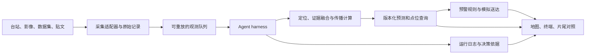

# RUNOUT · 从灾害演示到可运行的预警 Agent

2026-11-11 · 实施计划 · 当前交付范围为规划

## 1. 目标与现状

RUNOUT 的主产品是一条**能现场启动、逐条读取数据、生成初报、在新证据到达后修订并按地理位置送达的预警链**。地图、手机和演出都读这条链产生的事件。观众应该能改变一条输入、关掉一个测站、输入一个新经纬度，并看到结果随之变化。

当前版本已具备 10 个喜马拉雅演练、1 个安第斯案例、连续时钟、自由视角和基于 DEM 的任意点查询。本地模型检查通过 11 个场景。当前 `runout-timeline.js` 里的 `signalsFor()` 根据预设的送达时间倒推线索出现时刻，`phoneNotice()` 又用场景设定的到达时刻生成提示，`summaryFor()` 采用人为延迟 6 分钟的对照。这些适合影片回放，不能作为 Agent 的输入、实时预测结果或效果验证。吉隆口岸 T+07:21 是拟合锚点；现有灾后掩膜重合度是开发诊断。

完成后的三项主交付：

| 入口 | 用户可完成的事 |
|---|---|
| **演出 / 地图** | 同一场实时运行里看清溢流、受影响点，以及不同终端按实际模拟送达顺序弹出；输入经纬度或点图，查看最新预警与候选行动。 |
| **Agent Live / 运行台** | 启动数据回放、暂停和加速、查看输入队列、实际工具调用、筛选与修订结果；可切换到简洁的「决策依据」视图。 |
| **方法与证据** | 查看架构、数据来源、版本、历史验证和实验对照；按案例、数据类别和失败原因展开，直接复跑评估。 |

## 2. 真实数据与证据清单

表中是已找到的获取入口。开发时逐项记录是否拿到原文件、许可、覆盖、处理方式和时效。下载得到历史资料，只能证明今天可获取。原始值真实与当时可实时获得是两个字段。

| 数据 | 优先获取的原始资料 | 用途、时效和替代方案 |
|---|---|---|
| **地震台站** | 2026-08-26 尼泊尔 NEMRC/DMG、SASIN 多站 MiniSEED，Zenodo v1.0 约 3.1 MB，并附 Readme。已核对 MiniSEED 可下载，MD5 为 `4751372c87f06eaa53c42ca62c302c27`，记录许可为 CC BY 4.0。建库时补记台站/通道、采样率、缺口与仪器响应。可用 EarthScope、GFZ/GEOFON FDSN 查询补充波形和台站信息。 | 回放波形并运行版本化检测器，产出「振动异常、候选时刻、匹配台站」。单站振动不能唯一确认泥石流；公开档案也不证明实时延迟。优先量测尼泊尔本地台站，全球远场记录适合事后校核。 [尼泊尔台网事件报告](https://seismoschoolnp.org/2026/09/11/august-26-mass-movement-and-flood/) · [原始 MiniSEED](https://zenodo.org/records/22338896) · [EarthScope 事件数据](https://ngf.earthscope.org/geophysical-event/us7000tbwb-nepal-glacial-collapse-and-debris-flow) · [GEOFON FDSN](https://geofon.gfz.de/waveform/webservices/fdsnws.php) |
| **河道与雨量站** | Nepal DHM 水情页和站表。首批登记 Rasuwagadhi、Timure、Syapru Besi 附近可获得站点，再查 Betrawati、Galchhi、Malekhu 方向；核实站号、坐标、监测变量、单位、水位基准和停站时间。向运营方获取历史序列与站点日志。 | 水位突变或已核验相机过流可约束波前。站点停报单独入库，不能直接当成过流。公开网页不等同历史原始 API 或秒级 SLA。拿不到时，用报告里可追溯的时刻作低粒度锚点，持续序列用明确标记的演练数据。 [DHM 水情监测](https://www.dhm.gov.np/bhasa/hydrology_floodMonitoring/np) · [DHM 数据申请](https://dhm.gov.np/pages/data) |
| **卫星原始产品** | 对中尼边境 AOI 按事件前后分别列 Sentinel-1 SAR 和 Sentinel-2 L2A 产品清单，记录产品 ID、获取和发布时间、轨道、云量、处理级别及质量掩膜。保存一对可对比产品及裁切产物。 | SAR 和光学主要用于源区变化、冰湖、受影响范围和事后复盘。Sentinel-2 标称 5 天重访，实际过境、云和下发另计。影像到达之前对 Agent 不可见。演出开场 NASA Blue Marble 仅为地理底图。 [ESA Sentinel-1/2](https://www.esa.int/Enabling_Support/Operations/Copernicus_Sentinels) · [Sentinel-2 参数](https://www.esa.int/et/missions/about-us/directorates/earth-observation-programmes/copernicus/sentinel-2) · [Copernicus 产品检索](https://documentation.dataspace.copernicus.eu/APIs/OData.html) · [NASA GIBS](https://nasa-gibs.github.io/gibs-api-docs/access-basics/) |
| **降雨与地形** | NASA GPM IMERG Early，Copernicus GLO-30、HydroRIVERS，必要时补当地站或测绘部门断面、桥梁与步道图。 | IMERG 半小时格点和约 4 小时 Early 延迟适合降雨背景与风险先验。现有约 110 米/60 米推演网格不能核实桥面、街道或避难点。河网作为流域骨架，支沟、鞍部与出口要结合地形复核。 [NASA IMERG](https://gpm.nasa.gov/data/imerg) · [GLO-30](https://registry.opendata.aws/copernicus-dem/) · [HydroRIVERS](https://www.hydrosheds.org/products/hydrorivers) |
| **灾后范围** | Copernicus EMSR927 下载 Syapru Besi、Timure 等 AOI 原始分级包，记录观察范围、影像时间与 `observedEventA` 分类。叠加现场报告和路桥受损位置。 | 用于离线验证，不能作为同一事件早期 Agent 输入。地图只标注覆盖到的受影响区，图外与云遮挡为未知。灾后影响多边形不是逐时流深或完整淹没真值。 [可下载 AOI 和矢量](https://ihp-wins.unesco.org/en/dataset/damage-grading-syapru-besi-and-timure-rasuwa-district-nepal-27-august-2026) · [官方激活](https://mapping.emergency.copernicus.eu/news/flood-in-nepal-emsr927/) |
| **X / 居民贴文** | 第一版导入本地三语标注库，真实贴文仅在授权和用途可核实后接官方 X API，记录贴文 ID、位置字段、时间与版本，保留必要的最少文本。 | 不依赖社交平台接入来启动演示。作者地点、文中提及地点、目击地点分别解析；缺定位的贴文不能变成精确 GPS。请求配额、访问与内容留存条件在接入时核对。 [X 官方检索接口](https://docs.x.com/x-api/posts/search/quickstart/recent-search) |

**已找到的尼泊尔下游原始序列路径。** CHWRR 技术报告提供预警发送时点、站点最后记录、下游水位与阈值记录；公开目录记录了 DHM 历史请求及覆盖。优先拉取 Kali Khola 和 Devghat 的历史十分钟序列，交叉核对 Betrawati、Furke/Malekhu 等锚点。Betrawati 的站页和公开历史查询已验证可访问，原始水位基准及再分发条款仍需核对。Rasuwagadhi、Syabrubesi 和 Betrawati 的部分序列在事件中断，报告的站名或时间标签若不一致，保留原文和冲突标记。最后一条记录只可作为停止观测的线索。尼泊尔报告中 09:15、09:16 是 NPT 的发送记录，不能推断个人手机送达时间。 [尼泊尔官方 CHWRR 技术报告](https://hydrology.gov.np/cm/files/Bhotekoshi-Trishuli-Narayani_Flood_Report_CHWRR_1%20_1787809133090.pdf) · [DHM 历史观测检索记录](https://evelpidou.nkua.cloud/Nepal-Flood-2026-Catalogue/searches/RUN-20260908-041/) · [Betrawati 站](https://dhm.gov.np/hydrology/hms-Single/52)

**卫星优先下载顺序。** 先用 ESA 列出的事件前后 Sentinel-2 和 8 月 26 日 Landsat-9 定位合适场景；记录 Landsat-9 是崩塌后约两小时取得，不能用于分钟级初报。另登记 8 月 26 日 PlanetScope、8 月 27 日 SkySat/Pelican 和 Vantor 公开灾害 STAC 目录，供授权范围内的精细比对。Planet/Vantor 目录标注非商业许可，纳入对外展示或后续产品前复核。同步登记 UNOSAT 的灾后判读面和分析覆盖，避免拿缺图区域算真阴性。 [ESA 影像对照](https://www.esa.int/articles/about-us/directorates/earth-observation-programmes/copernicus/sentinel-2/nepal-flash-flood-imaged-by-satellites) · [Planet 原始资产目录](https://data.source.coop/planet/disasterdata/nepal-flash-flood-2026-08-26/catalog.json) · [Vantor 原始资产目录](https://vantor-opendata.s3.amazonaws.com/events/Nepal-Flooding-Aug-2026/collection.json) · [UNOSAT 矢量资料](https://ihp-wins.unesco.org/en/dataset/nepal-satellite-detected-mudflow-and-rockflow-extent-nepal)

**尼泊尔侧证据单独建索引。** 用尼泊尔红十字会在 Rasuwa 拍摄的灾中画面、尼泊尔警方影像和 Reuters 在 Trishuli 河段的航拍，核查波头、漫过河槽、谷底路桥和建筑受损。逐条记录原拍摄者、发布日期、地点范围、是否可核验时间、许可和能支持的结论。标注不能精确定位的镜头；许可未落实时以链接或制作参考交付。吉隆口岸 CCTV 提供另一个视角，但画面高度不能直接换算成流深。 [尼泊尔红十字会拍摄的 Rasuwa 视频](https://www.euronews.com/video/2026/08/27/nepal-flash-flood-dramatic-footage-shows-rasuwa-valley-engulfed) · [尼泊尔警方影像转载](https://www.yahoo.com/news/videos/flash-floods-sweep-nepal-near-143258635.html) · [Reuters Trishuli 航拍](https://www.reutersconnect.com/item/drone-footage-shows-extent-of-destruction-after-deadly-flood-in-nepal/dGFnOnJldXRlcnMuY29tLDIwMjY6bmV3c21sX1ZBODM2OTI3MDgyMDI2UlAx) · [吉隆口岸 CCTV](https://commons.wikimedia.org/wiki/File:Mudslide_at_Gyirong_Port_1.webm)

**按场景锁定证据用途。** 2026 吉隆用源区、口岸 CCTV 和公开报告建立开发锚点，尽可能保留 Timure、Syapru Besi 或更下游的独立观察作校验。2025 Purepu 是另一次冰面湖溃决。2024 尼泊尔 Thame 使用 NDRRMA/ICIMOD 实地复盘作为境内冰湖链式灾害补充。2017 Villa Santa Lucía 用于对照峡谷传播与冲积扇扩展。已经用来选参数的点位或案例进入开发集；真正跨流域验证用事先冻结的另一流域或新资料。可把尼泊尔 Melamchi 的多期高分辨率 DSM 作为独立的侵蚀、堆积和横向范围对照；DSM 缺少逐分钟到达真值，不能用它评分 ETA。 [2026 ICIMOD 复盘](https://lib.icimod.org/records/r745z-mvm84) · [2026 吉隆动力学研究](https://jms.imde.ac.cn/en/article/doi/10.1007/s11629-026-1482-y?viewType=HTML) · [2025 Purepu 简报](https://ndrrma.gov.np/mediafiles/publications/Rasuwagadhi_Flood_Sitrep1_08072025_.pdf) · [2024 Thame 实地调查](https://lib.icimod.org/records/8g9ze-1r153) · [Villa Santa Lucía 研究](https://nhess.copernicus.org/articles/20/2319/2020/) · [Melamchi 多期 DSM](https://portal.opentopography.org/dataspace/dataset?opentopoID=OTDS.102024.32645.1)

## 3. 数据库、回放与 Agent harness

**运行方案。** 复用现有浏览器和 JS 地形代码。新建一个本地 Node 24 服务，采用 SQLite（已在现有 Node 24.20 进程确认内存 SQLite 可用）、原始文件目录及 SSE 事件流。先交付能离线运行的单机版；大栅格按版本放文件，数据库存元数据、索引、引用和事件。原始影像及波形可按数据清单重建，演示包只带许可允许的必要样本或派生物。 [Node 24 SQLite 文档](https://nodejs.org/download/release/latest-v24.x/docs/api/sqlite.html)

| 模块 | 实现与验收 |
|---|---|
| **A. 采集适配器** | `waveform`、`gauge`、`satellite`、`post`、`manual` 统一输出观测记录。保存原始文件哈希、原始来源、授权、采集状态、质量标志和解析器版本。超时、限流、缺测与数据为空分别记录。把大文件预处理为可回放的台站窗口或影像变更事件，保留回指原始记录的链接。 |
| **B. 小型数据库** | 表最少包括 `sources`、`raw_assets`、`observations`、`post_labels`、`runs`、`run_events`、`forecast_versions`、`alert_versions`、`deliveries` 与预先登记的 `terminals/routes`。本地文本索引、时间和流域查询须可用。独立评分库存灾后多边形、实测锚点及合成真值，Agent 账号和工具访问路径隔离。 |
| **C. 虚拟时钟** | 统一用 UTC 存 `observed_at`（观测发生）、`published_at`（来源发布）、`available_at`（此运行可见）和 `ingested_at`（服务接收）。缺失的原始时效标未知。回放配置单独记录假设延迟，按 `available_at + seq` 稳定排序。每轮只处理当前可见前缀。暂停、加速与重开由同一时钟控制；拖动到过去读相应快照，改变输入从该点创建分支。禁止把后来公开的灾后影像带回灾前。 |
| **D. Agent harness** | 常驻事件循环接新观测、选择下一步工具、读取返回并决定重算或等待。每次工具调用记录 `started/succeeded/failed`、参数摘要、证据 ID、耗时与产物版本。工具白名单包括 `query_observations`、`extract_claim`、`match_location`、`check_independence`、`revise_forecast`、`query_position`、`plan_route` 和 `propose_alert`。先做可重复的本地协调器；增加实际模型驱动的结构化文本提取与工具选择适配器，在至少一场运行中显示真实的调用结果、超时和回退。离线模式显示实际规则执行，模型模式显示实际模型调用，录屏单独标回放。 |
| **E. 安全与一致性** | 贴文、OCR 和外链均作为不可信数据。文本只能提供候选主张及引用片段，不能改权限、执行命令、控制发布、生成坐标真值或直接填写 ETA。告警经独立规则和模拟送达端。用 `run_id + seq` 唯一键、源记录指纹和通知幂等键防止重放重复送达；事务内保存事件与快照，SSE 断线后按游标补齐。外部模型不可用时转规则并记录降级，必要时保留旧版或暂停行动建议。 |

**贴文种子库第一阶段目标为 120 条。** 建议 65 条正常内容、25 条含现场线索的合成贴文、30 条旧闻搬运、转发、错地名、同名河流、天气聊天或诱导文本。涵盖中英尼三语及译名变体，包含发布晚于目击、无定位、同图多转和帖子引用他人等例子。每条保留生成方式、语言、事件族、候选地点、时间和标签。相同事件和转发簇必须一起划分，评估集不进提示词或人工调参。正常帖子无须跟灾情有关，至少覆盖旅游、交通、当地生活与日常降雨。

**两种 Agent 视图读同一个运行日志。** 「运行台」像 harness，展示队列推进、调用哪个工具、返回了什么、下一次为何重算及失败重试。「决策依据」像开发助手的进展摘要，只显示结论、引用证据、仍缺的信息和下一步动作。用可复核的证据与决策摘要表达推理依据，界面无需展示模型私有思考文本。示例信息应是「居民贴文提到 Timure 但目击地点不明；两个转发同属一个来源；水位站确认下游河段过流；预测从 v1 更新到 v2」，每项都可点到输入及时间。

## 4. 从证据到预警的计算

1. **发现候选事件。** 台站异常、已核验相机、水位突变或可靠发布触发候选。帖子工具先判断是否现场目击、是否旧闻、地点是否可定位和是否存在独立证据。同图、同原文、同作者转载只计一个证据族。单条地点模糊的贴文可以开启查证或扩宽候选区域。它本身不能提升为明确撤离指令，也不能独立改写流速。雨量提供易发背景；无降雨也可能发生冰岩崩。
2. **形成初报。** 用源区候选和已知河网、DEM、灾害类型选择一组物理参数范围，得到首波、后续波、可能影响区和抵达窗口。候选源区可以多于一个。受影响判断依赖河网、地形和可用模型覆盖，不使用直线距离。窗口由可解释的参数集合产生，不把集合支持率当成已校准概率。首报写出覆盖、数据时效、独立证据数及缺口。
3. **随观测修订。** 有准确时间与位置的相机、河道站或核验后的报告可约束某条波前到达某河段。按残差与质量重加权或排除不相容参数，重算受影响的下游段；观测冲突时保留备选或降级。社交线索主要调整候选河段和查证优先级。第二个源独立保留，只有水力连通且时序重叠才测试汇流增强。快慢两组预测均无法解释数据时，扩大区间或返回资料不足。每个修订保存旧窗口、新窗口、变化量、触发证据、模型与参数版本。
4. **按位置拟合行动。** 先按预先登记的终端与位置误差匹配预测多边形，再查点位的最早到达、范围、时间窗及路线。建议状态包含「演练撤离」「提高警戒」「本模型未检出影响」和「资料不足」。失联、资料陈旧或定位横跨影响边界时保留不确定性。路线或下一波变化触发更新；微小波动可以合并，重大变化即时更新。先存 `Alert`、`Update`、`Cancel` 再进入模拟送达队列，区分排队、发出、送达、确认、失败和撤回。过了估计波尾不自动解除。
5. **冻结可追溯输出。** 对外字段由规则与模型工具生成，包含 `forecast_version`、`as_of`、证据 ID、位置有效范围、警报生命周期和模拟终端收到时间。固定时间、输入流、初始状态与模型版本可复跑。若启用非确定模型，复跑分「重放已记录工具结果」和「再次实际请求模型」；后者保留模型版本、耗时、成本和差异。

传播计算先复用当前地形核作为带版本的简化基线，同时把 `model` 拆为「先验」「可同化的传播工具」「评分真值」三部分。首版先在独立波前和几组速度/衰减参数上闭环；需要可信的深度与冲击强度时，接入局部二维深度平均或多相求解并做敏感性分析。可先用 Villa Santa Lucía 的现场研究对比 r.avaflow 的输出和验证方式。未校核的流体高度用于渲染，受影响程度先用「河槽/岸边暴露、越岸可能、缺资料」等可解释标签。米数、流速、烈度等级及概率在其依据与验证满足后才显示。 [r.avaflow](https://www.avaflow.org/) · [Villa Santa Lucía 现场与模型对照](https://nhess.copernicus.org/articles/20/2319/2020/)

## 5. 经纬度输入与详细行动指导

对每个用户输入，保留 WGS84 坐标、位置精度、查询时刻和预测版本。坐标输入明确标经度、纬度，范围与顺序校验，服务内部用 GeoJSON 的 `[lon, lat]`。查询先找有覆盖的流域，再判定定位误差圈与风险区的关系。有证据时输出候选源区的经纬度、方位和来源；仅知道大致河段时显示范围。区分「首波到达窗口」「仍可能有后续波」「估计影响持续」「何时解除」。到达区间应明确是预测时间，并给数据过期时间。 [GeoJSON RFC 7946](https://www.rfc-editor.org/rfc/rfc7946)

**首屏最多四项。** 预警级别及行动一句、距最早可能到达、可用撤离余量、更新时间。第二层展示源区、影响程度依据、路线、集合点海拔和预计步行时间。以下内容仅为版式样例，时间和地点均为演练设定。

> **演练 · 立即撤离**  
> 你所在河谷点位最早约 5 分钟后受影响。当前演练路线预计 3 分钟，预留 1 分钟后还有约 1 分钟余量。  
> 源区约在上游东侧，点击展开可查看经纬度范围。走本场已设定的侧向上坡路线 A，沿标记到集合点。展开查看海拔、相对爬升及已避开的桥梁。  
> 已送达 v2 · 此版本由下游站观测修订。

路线工具的实现分两级：

- **演练级。** 结合步道图、坡度、涉水边、桥梁和地形不确定性，用可计算时刻的路径搜索。每段的预计通过时间必须早于该段最早到波或关闭时刻并留缓冲；不能只比较居民点 ETA。候选集合点须有可用路段且在本场保守影响区外，避开其他活动沟槽。输出集合点海拔、相对爬升、距离、步行和余量，支持普通及慢速步行。用尼泊尔道路部门的封闭历史核对路段，但日级公告不作为单桥断裂的分钟锚点。只用 DEM 的候选路径醒目标示待校核；无可达路线时明确提示路线未确认，不给虚假的安全海拔或跳进另一条沟的指令。 [Nepal DoR 道路封闭历史](https://navigate.dor.gov.np/app/road-closure-history)
- **试点级。** 只引用当地主管机构预先确认的逃生路线、集合点、封闭边和不同人群的疏散预案；由值班员审查受影响范围和下发文案。路线未知、已过流或地区规则冲突时使用当地批准的提示。不同灾种、坡面和现场状态需要不同动作，不能把单一高度或方向套给所有人。正式推送接入独立的授权发布方。 [USGS 泥石流风险与地方预案](https://pubs.usgs.gov/fs/fs-176-97/fs-176-97.html) · [OASIS CAP 1.2](https://docs.oasis-open.org/emergency/cap/v1.2/CAP-v1.2.html)

演练可导出 CAP 1.2 的 `status=Exercise`，落到封闭模拟接收端。转换测试要覆盖 CAP 地理点的纬度/经度顺序、GeoJSON 相反顺序、UTC 时刻，以及更新或撤回对旧版的引用。展示版只保存必要的模拟位置；真实终端位置需明确授权、最少留存与访问控制。跨境接入按双方的官方预警渠道和语言校核。

## 6. 同场显示 Agent、预警与溢流

- **同源展示。** 桌面左侧保留大地图，右侧显示「决策依据」或「运行台」，用同一播放时钟并行推进。手机视图默认一条主要结论，工具详情抽屉展开。地图读预测版本，手机读实际模拟 `delivery`；影片可以换镜但不会造出新的证据或送达。迟到、无路线、工具失败和无影响也是场景成果。
- **全景中的连续送达。** 先定位可解释的分发节点，再按送达时间逐个点亮口岸、Timure 和下游；同一时刻以固定点位顺序做视觉排布，标签保留真实的模拟送达时刻。信号线区分发出与到达，地图卡片和手机消息同时反映同一个终端。新版本替换旧卡并留下版本记录；一屏容纳不下时用 `+N`、边缘提示和可展开接收列表。验收同时覆盖至少 12 个终端和重复送达。声音短、可关闭，不影响读取文字。
- **喜马拉雅溢流。** 先做吉隆汇入口、一个尼泊尔侧低滩或扇面、双源汇流三处。用有明确时间的连通湿区、越岸低点、受限回冲和退水驱动可见水面，按首波/第二波进展向外铺开。狭谷保持约束，扇面允许扇形扩张，越脊必须有低鞍通道和水头依据。观察掩膜、预测面与演出材质可以分别显示；视觉加宽、泡沫和尘雾与实际警报边界分开。先用现场片段和灾后多边形核对机制，再做细化。
- **扩大地图、提高质感。** 以完整子流域、支流、潜在下游点和缓冲区定义覆盖范围，扩 DEM 数据而非拉伸网格。做区域影像、中距 DEM 和局部高细节的分层，优先吉隆、Timure、Syapru Besi 的河岸、路桥和坡面。使用有来源的较高分辨率纹理、地形分块、法线、远近面数切换和设备质量档。局部缺少高程断面时把渲染细节和分析分辨率分别标记。先在本机 Chrome 与 390px 窄屏验证不卡住输入与预警，再扩到其他设备；WebGL 不可用时提供可用的 2D 地图和消息列表。
- **方法页与 COP31。** 展示数据出处、案例是否参与拟合、模型变更前后、逐点误差、模型拒答、误报漏报和失败回放。片尾只用真实运行日志算提前量与演练完成点位，标明样本数和条件。高山变暖与 ENSO 的区域降雨影响用于说明适应背景，个案成因仍以该事件的独立证据为准。 [IPCC 高山风险](https://www.ipcc.ch/report/ar6/wg2/chapter/ccp5/) · [WMO ENSO](https://wmo.int/themes/el-nino-la-nina-phenomena) · [COP31 Early Warnings for All](https://unfccc.int/cop31/high-level)

## 7. 怎样证明运行有效

**锁定评测。** 先登记评估点位，包括未受影响、靠边界、失联和错误地名。登记后再运行预测。把开发/校准事件、历史回放、冻结的独立资料和合成压力测试分开。先测相同信息流下的三条基线：静态首报、同规则的确定性多源融合、接入 Agent 提取和工具选择的多源融合。另做现场测站较晚收到数据的操作情景；其延迟来自可证实日志或明确假设。上一版「额外晚 6 分钟」只保留为敏感性示例。

| 验证问题 | 指标与验收方式 |
|---|---|
| **有没有真的运行** | 启动新运行时至少看到一条正常贴文被排除、一条含歧义贴文被暂缓、一个工具真实返回、一次预测更新与多个终端送达；拔掉一个来源或插入一条带时间戳的新观测，输出可复核地改变。重跑相同输入的规则版本时，事件前缀一致。改动未来观测或评分真值，过去前缀应完全相同。 |
| **贴文筛选是否可靠** | 按事件族、转发簇和语言划分，报告精确率、召回率、错误来源和样本数，单列正常内容误报。首轮可用 0.85 精确率和 0.80 召回率作验收目标；小样本报告区间，达不到就保留为候选证据流程，不提升预警权限。 |
| **路径、面积、时间是否更准** | 对未用于拟合的有时间锚点记录 ETA MAE、中位与 P90 误差、区间覆盖率和区间宽度，按首波与后续波分别统计。对有灾后制图的 AOI 比覆盖、IoU、漏画和多画，图外不计入未受影响。必须同时给可评估样本数、资料不足比例及拟合点列表。 |
| **预警改善了多少** | 逐点用实际或合成真值的到达时刻减该运行终端送达时刻，得到提前量。再扣反应、步行和缓冲，考虑桥先失效及路线分段冲击，得到净撤离余量。对比误报、漏报、迟报、撤回、成功送达与模拟完成点位。真实运营方发出时间与终端收到时间分别记录，缺少历史送达时不得把模拟改进写成历史事实或减少伤亡人数。 |
| **性能与稳健性** | 首轮本机目标设为热启动单点查询 P95 ≤ 1 秒、规则回放从观测进入到初报或修订 P95 ≤ 2 秒；公开场景规模、设备、测量次数和冷启动开销。真实模型调用另计排队、工具、推理和送达 P50/P95，失败率和重试单列。验证迟到、重复、相同时间戳、断线补读、数据丢失、双源、断桥、边界和坐标顺序。 |
| **能否迁移** | 给 Agent 未预设的流域坐标、来源和时间序列，靠加载 DEM/河网、配置传感器、起始先验和接收区来运行。至少一组独立流域或事件族锁定后盲测，加入同流域新点、邻谷点、覆盖外点和不同灾种。即便模型能跑，仍应单列该流域的校核状态。 |

## 8. 工作顺序与交付门槛

| 优先级 | 子智能体分工与交付 | 合并门槛 |
|---|---|---|
| **P0 · 数据与接口** | 数据智能体维护来源和许可清单、MiniSEED 转换、台站资料、尼泊尔视频索引和三语贴文种子。主智能体冻结观测、预测、告警和日志接口，登记接收点与数据分割。 | 一个命令建库并导入至少一项真实原始数据派生的观测、明确标注的模拟站流和贴文库。数据出处可追，真实和合成标签在页面上可见。 |
| **P0 · 运行链** | Harness 智能体实现时钟、调度、工具日志、证据筛选、SSE 和规则或真实模型适配器。传播智能体做独立预测模块、修订版本及同一坐标的查询。 | 用 **01** 从混杂输入跑出 v1、v2、分发送达和下游点查询。用户增加、删去或延迟输入，结果随之改变。先跑规则版本，再验证至少一场文本模型驱动的工具调用及失败回退。旧影片路径明确标为「预录演示」。 |
| **P1 · 风险与疏散** | 传播智能体做水位和时间窗、低滩溢流及双源；路线智能体或同一负责人做道路图、桥梁时限和候选路径。数据智能体冻结盲测集。 | **07** 双源更新、**09** 失联、**10** 断桥均通过；点选或经纬度输入能区分可撤离、来不及、资料不足和模型范围外；安第斯与新增独立流域分开报告。 |
| **P1 · 演出与方法页** | 界面智能体用同一日志接入地图、手机、运行台、决策依据和方法页；渲染负责人扩大地形、做局部精细网格和溢流。主智能体验收剪辑、日志和预测版本一致。 | 连续回放能同时看到工具和地图；不同终端按送达依次亮起；断线重连不重复。其余场景在迁移中可标为预录。正式交付时，10 个喜马拉雅演练和安第斯案例都能启动 Agent 运行，并逐一通过接口、时间线和数据标签验证。 |
| **P2 · 现场试点** | 在取得监测数据和地方伙伴参与后，做区域参数、路线、告警发布和断网回退校核。设计只读影子运行，再组织演练与人工发布。 | 真实试点须有当地核验的危险区、接收范围与路线、有授权的值班流程、断电断网回退、监测时延记录和独立评估。观众演示、历史回放、模拟发送和正式告警各自使用明确状态。 |

**第一段现场验收脚本。** 打开 01 并新建运行，启动时钟；正常贴文经过、重复转发归并，台站观测触发初报；点击一个下游经纬度看窗口和路线；注入下一条确有时序的水位或相机观测，看到 v2 收窄、变宽或改变窗口；地图按实际模拟送达顺序点亮，手机展示更新。重跑时关掉上游来源，比较口岸与下游余量。最后打开方法页，从片尾指标点回对应送达、观测、预测版本和失败原因。

**工作边界。** 本文件是实施与验收计划。当前已交付的演出、基础模型和地形查询可作为素材与基线。Agent 服务、数据库、原始数据接入和盲测效果要以各阶段的可运行结果及可复查记录为准。
